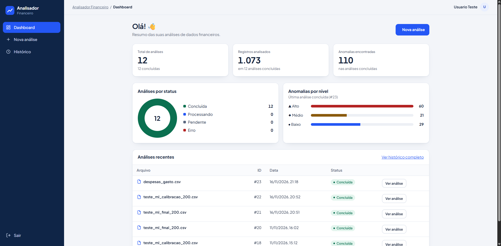
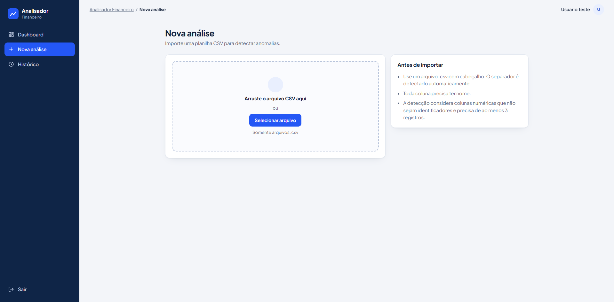
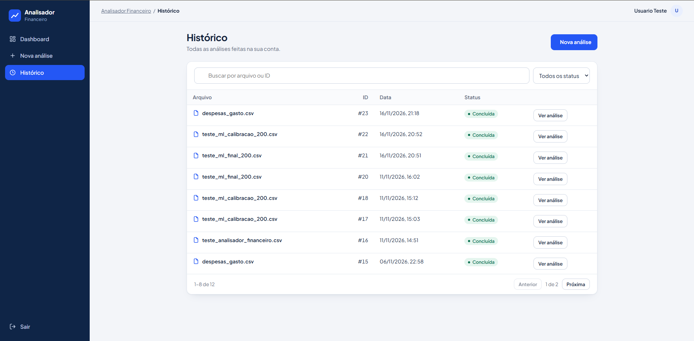
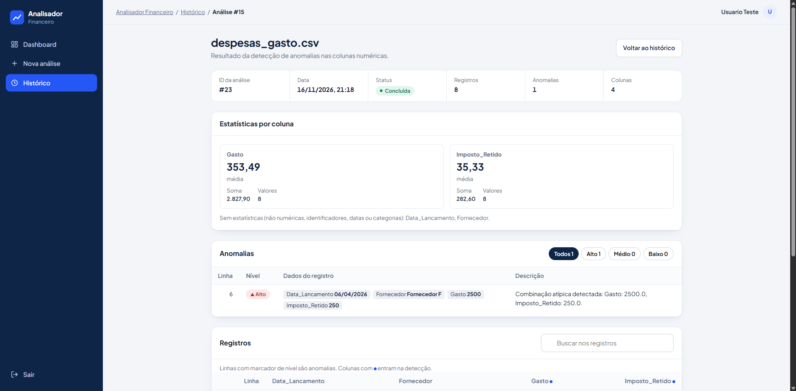

# Analisador Inteligente de Dados Financeiros

Sistema web desenvolvido para importar dados financeiros em formato CSV, analisar padrões e identificar registros que fogem do comportamento esperado por meio de Machine Learning.

O projeto foi desenvolvido como parte da Feira Tecnológica da ETEC e tem como objetivo demonstrar a aplicação prática de desenvolvimento web, banco de dados e aprendizado de máquina em um único sistema.

---

## 📌 Sobre o projeto

O Analisador Inteligente de Dados Financeiros permite que o usuário envie um arquivo CSV contendo dados financeiros para que o sistema faça automaticamente:

- Importação e armazenamento dos dados;
- Identificação dos tipos e papéis das colunas;
- Seleção das colunas numéricas relevantes;
- Detecção de possíveis anomalias;
- Classificação das anomalias por nível de atipicidade;
- Cálculo de estatísticas dos dados;
- Visualização dos resultados em um dashboard;
- Consulta do histórico de análises realizadas.

A proposta é facilitar a identificação de registros que apresentam comportamento diferente do padrão encontrado no conjunto de dados.

> **Importante:** os níveis de anomalia representam o grau de atipicidade encontrado pelo modelo e não devem ser interpretados como classificação de risco financeiro.

---

## 🚀 Funcionalidades

### 🔐 Autenticação

- Cadastro de usuários;
- Confirmação de senha;
- Login com e-mail e senha;
- Senhas armazenadas com hash;
- Controle de sessão;
- Logout.

### 📂 Importação de dados

- Upload de arquivos CSV;
- Validação do arquivo;
- Detecção automática do separador;
- Leitura de cabeçalhos;
- Armazenamento dos registros no banco de dados.

### 🤖 Análise inteligente

O sistema utiliza Machine Learning para identificar registros que fogem do padrão dos dados.

O processo inclui:

1. Identificação das colunas;
2. Classificação das colunas;
3. Exclusão de possíveis identificadores;
4. Seleção das variáveis numéricas relevantes;
5. Aplicação do algoritmo Isolation Forest;
6. Classificação das anomalias.

### 📊 Estatísticas

A análise apresenta informações como:

- Quantidade de registros;
- Quantidade de anomalias;
- Soma dos valores;
- Média;
- Quantidade de valores analisados.

### 🔎 Resultados

O usuário pode visualizar:

- Registros analisados;
- Anomalias encontradas;
- Nível de cada anomalia;
- Linha correspondente no arquivo;
- Dados do registro;
- Descrição da anomalia;
- Estatísticas das colunas.

### 📚 Histórico

Todas as análises realizadas ficam disponíveis no histórico do usuário, permitindo acessar novamente os resultados das análises concluídas.

---

## 🧠 Machine Learning

A detecção de anomalias utiliza o algoritmo **Isolation Forest**, disponível na biblioteca Scikit-learn.

O algoritmo procura identificar observações que apresentam comportamento diferente do restante dos dados.

Antes da aplicação do modelo, o sistema realiza uma etapa de classificação das colunas para evitar que campos identificadores, como IDs sequenciais, sejam utilizados indevidamente na detecção.

Exemplo:

```text
ID_Transacao → identificador
Quantidade   → numérico
Valor        → numérico
Status       → categórico
```

Nesse caso, `ID_Transacao` não é utilizada como variável para detecção de anomalias.

---

## 🏗️ Arquitetura

O sistema é dividido em três partes principais:

```text
Frontend
   ↓
API REST
   ↓
Banco de Dados + Machine Learning
```

### Frontend

Desenvolvido utilizando:

- HTML
- CSS
- JavaScript
- Chart.js

### Backend

Desenvolvido utilizando:

- Python
- Flask
- Pandas
- Scikit-learn
- MySQL Connector
- python-dotenv
- email-validator

### Banco de dados

O sistema utiliza MySQL para armazenar:

- Usuários;
- Importações;
- Registros;
- Análises;
- Anomalias.

---

## 🔄 Fluxo do sistema

O funcionamento principal segue o fluxo:

```text
Cadastro/Login
      ↓
Importação do CSV
      ↓
Armazenamento dos registros
      ↓
Criação da análise
      ↓
Classificação das colunas
      ↓
Detecção de anomalias
      ↓
Cálculo das estatísticas
      ↓
Resultado
      ↓
Dashboard / Histórico / Detalhes
```

---

## 🗃️ Estrutura do banco de dados

O banco utiliza as seguintes entidades principais:

### `usuario`

Armazena os usuários do sistema.

### `importacao`

Relaciona o usuário ao arquivo importado.

### `registro`

Armazena cada linha do arquivo importado em formato JSON.

### `analise`

Controla o estado de processamento da análise.

Estados possíveis:

```text
PENDENTE
PROCESSANDO
CONCLUIDA
ERRO
```

### `anomalia`

Armazena os registros identificados como fora do padrão.

Níveis possíveis:

```text
BAIXO
MEDIO
ALTO
```

---

## 📁 Estrutura do projeto

```text
analisador-financeiro/
│
├── backend/
│   ├── app.py
│   ├── database/
│   ├── routes/
│   ├── services/
│   └── ...
│
├── frontend/
│   ├── assets/
│   ├── css/
│   ├── js/
│   └── pages/
│
├── data/
│
├── .gitignore
├── requirements.txt
└── README.md
```

---

## 🖥️ Telas do sistema

O sistema possui cinco telas principais:

### Login e Cadastro

Autenticação do usuário em uma única interface.

### Dashboard

Apresenta um resumo das análises e dos registros processados.

### Nova Análise

Permite importar um arquivo CSV e iniciar uma nova análise.

### Histórico

Exibe as análises realizadas pelo usuário.

### Detalhes da Análise

Apresenta os resultados completos de uma análise, incluindo estatísticas, registros e anomalias.

---

## 📸 Screenshots

### Login


### Dashboard



### Nova análise



### Histórico



### Detalhes da análise



> As imagens acima devem ser adicionadas à pasta `frontend/assets/screenshots/`.

---

## ⚙️ Como executar

### 1. Clone o repositório

```bash
git clone https://github.com/HarrSantos/analisador-financeiro.git

cd analisador-financeiro
```

### 2. Crie um ambiente virtual

Windows:

```bash
python -m venv venv
```

Ative o ambiente:

```bash
venv\Scripts\activate
```

### 3. Instale as dependências

```bash
pip install -r requirements.txt
```

### 4. Configure o banco de dados

Crie um banco MySQL chamado:

```text
analisador_financeiro
```

Configure as credenciais do banco e a chave da aplicação no arquivo `.env`.

Exemplo:

```env
DB_HOST=localhost
DB_USER=seu_usuario
DB_PASSWORD=sua_senha
DB_NAME=analisador_financeiro

FLASK_SECRET_KEY=sua_chave_secreta
```

> Nunca publique o arquivo `.env` no GitHub.

### 5. Execute o backend

```bash
python backend/app.py
```

O servidor será iniciado localmente.

### 6. Execute o frontend

O frontend pode ser executado utilizando uma extensão de servidor local, como o Live Server do VS Code.

Depois, acesse a página de login pelo endereço fornecido pelo servidor local.

---

## 📦 Principais dependências

```text
Flask
mysql-connector-python
python-dotenv
email-validator
pandas
scikit-learn
```

---

## 🧪 Exemplo de análise

Um arquivo pode possuir dados como:

```text
ID_Transacao | Ano | Status | Quantidade | Valor
1            | 2026| Pago   | 3          | 150.00
2            | 2026| Pago   | 5          | 240.00
3            | 2026| Pago   | 4          | 180.00
...
```

O sistema identifica o comportamento geral dos dados e procura registros que apresentem características significativamente diferentes.

Por exemplo, um registro com uma quantidade ou valor muito acima do padrão pode ser identificado como uma possível anomalia.

---

## 📈 Resultado dos testes

Durante os testes do modelo foi utilizado um conjunto de dados com **200 registros**, contendo registros considerados normais e registros propositalmente fora do padrão.

No conjunto utilizado para validação:

- 180 registros apresentavam comportamento normal;
- 20 registros foram utilizados como anomalias;
- As 20 anomalias foram identificadas;
- Não foram observados falsos positivos nos 180 registros normais utilizados nesse teste.

Esses resultados correspondem ao conjunto de dados utilizado durante os testes e não representam uma garantia de desempenho para qualquer outro conjunto de dados.

---

## 🔒 Segurança

O projeto possui algumas medidas básicas de segurança, incluindo:

- Hash de senhas;
- Controle de sessão;
- Rotas protegidas;
- Validação de dados recebidos pela API;
- Variáveis sensíveis armazenadas em `.env`;
- `.env` incluído no `.gitignore`.

---

## 🎯 Objetivos futuros

Algumas possibilidades para futuras versões incluem:

- Suporte a arquivos XLSX;
- Melhorias no modelo de detecção;
- Mais tipos de análises;
- Visualizações adicionais;
- Melhorias na experiência do usuário;
- Exportação dos resultados;
- Transformação do sistema em uma plataforma SaaS.

Essas funcionalidades não fazem parte da versão atual.

---

## 👨‍💻 Desenvolvimento

Projeto desenvolvido como parte da Feira Tecnológica da ETEC.

**Analisador Inteligente de Dados Financeiros**

Desenvolvido por:

- Harr Santos
- Equipe do projeto

---

## 📄 Status

**Versão 1.0 — Concluída**

O sistema atualmente possui o fluxo principal completo, desde a autenticação do usuário até a importação, análise e visualização dos resultados.

---

## 📜 Licença

Este projeto foi desenvolvido para fins educacionais e de demonstração.
